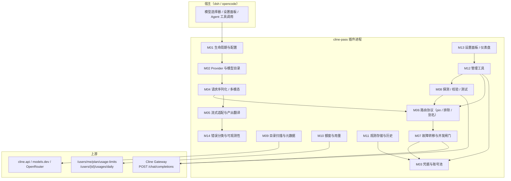
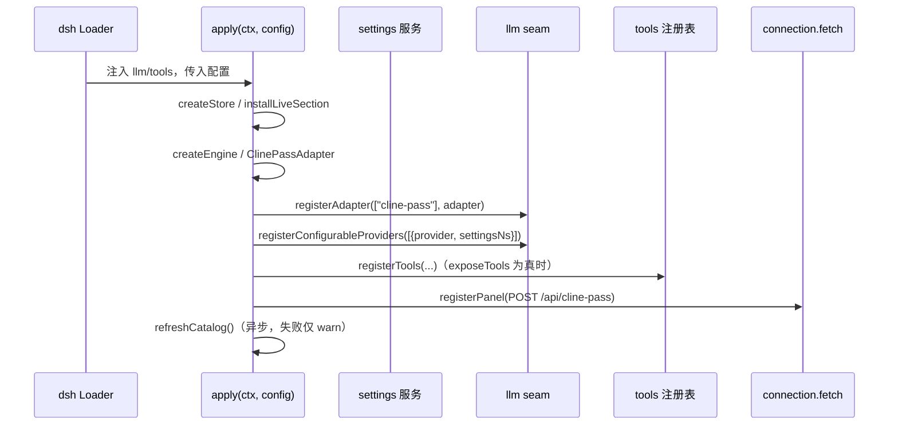
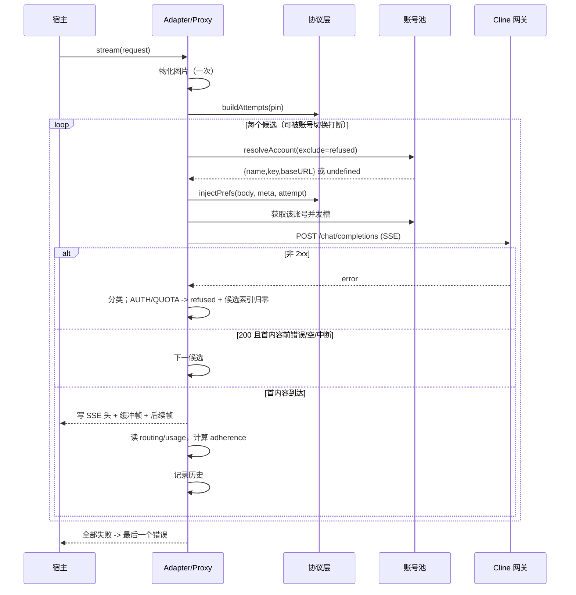
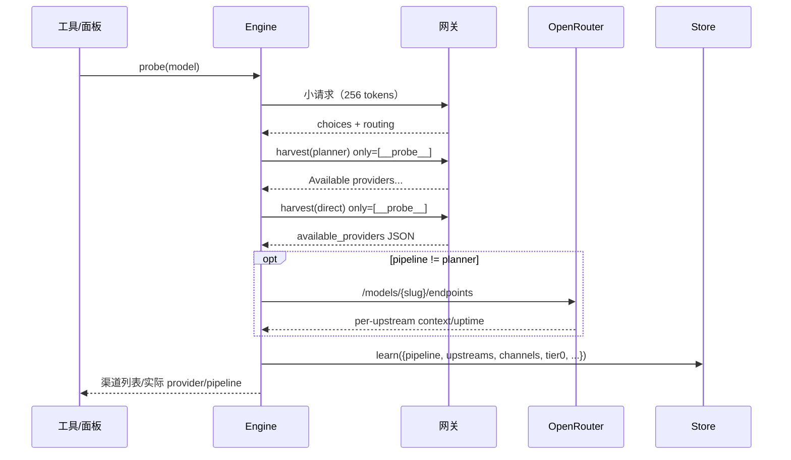
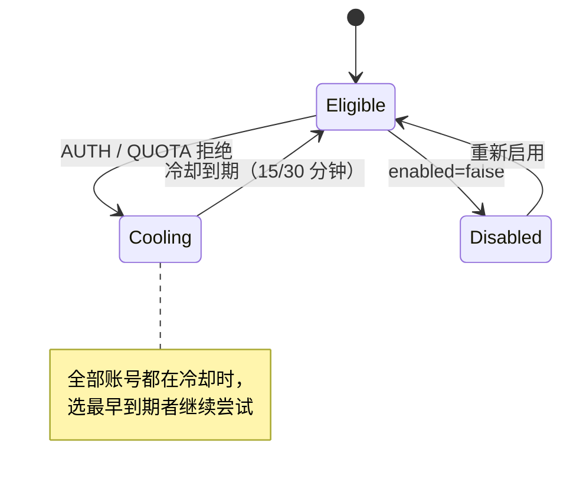

# dsh-cline-pass 功能模块文档

> 研究对象：[`yhshzh/dsh-cline-pass`](https://github.com/yhshzh/dsh-cline-pass) v0.2.8（构建标记 `dshfix-4`，MIT）。
> 目标：把该插件的**全部功能**按职责拆成可独立实现、可独立验收的模块，并作为本工作区 opencode 插件实现的规格说明。
>
> 文档约定：`Mxx` 为模块编号；「不变式」表示任何实现都必须成立的行为契约；`src/...` 是本工作区 opencode 实现中的对应文件。

---

## 1. 定位与总体能力

dsh-cline-pass 把 [Cline Pass](https://cline.bot/cline-pass) 订阅模型接入 DeepSeek Harness：

- 注册一个名为 `cline-pass` 的 LLM 提供方路由（provider route），模型直接出现在模型选择器中；
- 不需要额外代理进程，插件进程内完成协议转换与路由；
- 支持流式输出、工具调用、图片输入、reasoning（思考内容）；
- 支持多账号池、单账号/轮询、失败账号冷却；
- 支持探测模型背后的上游渠道（upstream/channel），并把渠道钉住（pin）、排除（exclude）或在首个 token 前故障转移；
- 提供 8 个 `cline_pass_*` 管理工具与一个 Web 设置面板；
- 提供额度（quota）读取、请求历史、每渠道可用性判定等观测能力。

### 1.1 逻辑分层



---

## 2. 功能模块总表

| 编号 | 模块 | 一句话职责 | 源码 |
| --- | --- | --- | --- |
| M01 | 插件生命周期与配置 | 注册路由、加载/热更新配置、组装各模块、启动扫描 | `lib/index.js`、`lib/compat.js` |
| M02 | Provider 与模型目录 | 把配置 + 内置目录 + 扫描结果解析成模型描述并对外广告 | `lib/index.js`、`lib/catalog.js` |
| M03 | 凭据与账号池 | 账号档案、凭据解析、单账号/轮询、失败冷却 | `lib/index.js`、`lib/accounts.js` |
| M04 | 请求序列化与多模态 | 把宿主消息树编码成 OpenAI 线格式，处理图片/工具结果顺序 | `lib/adapter.js` |
| M05 | 流式适配与产出翻译 | SSE 解析、增量→宿主 chunk、usage/finish 归一 | `lib/adapter.js`、`lib/engine.js` |
| M06 | 路由协议 | 双拼写 pin 注入、别名、排序、排除、adherence 判定、候选展开 | `lib/protocol.js` |
| M07 | 故障转移与并发闸门 | 候选链/账号链重试、首 token 前切换、每账号并发槽、空闲超时 | `lib/adapter.js` |
| M08 | 探测/校验/测试 | 探测 pipeline 与渠道、逐渠道真实验证、干跑 pin、密钥验证 | `lib/engine.js` |
| M09 | 目录扫描与模型元数据 | 官方清单 + models.dev + 网关 `/models`，采纳新模型 | `lib/cline.js`、`lib/catalog.js` |
| M10 | 额度与用量 | 5 小时/周/月额度窗口、每日按模型用量 | `lib/cline.js`、`lib/panel.js` |
| M11 | 观测存储与历史 | 模型发现结果、渠道判定、请求环形历史、目录/额度缓存 | `lib/store.js` |
| M12 | 管理工具 | 8 个 `cline_pass_*` 工具的 schema、执行与渲染 | `lib/tools.js` |
| M13 | 设置面板/仪表盘 | 账号、密钥、模型可见性、pin、探测、额度、历史 | `lib/panel.js`、`lib/client.js` |
| M14 | 错误分类与可观测性 | 稳定错误码、HTTP 映射、构建标记、日志 | `lib/adapter.js`、`lib/protocol.js` |

---

## 3. 模块详解

### M01 插件生命周期与配置

**职责**

1. 导出插件身份、依赖注入声明与默认值。
2. 解析插件配置（`Config` schema），把面板可写的字段标记为 live/volatile。
3. 组装 store、engine、adapter、control、tools、panel。
4. 在 LLM seam 上注册适配器与「可配置 Provider 目录项」。
5. 启动时触发一次目录扫描（失败只告警，不阻断启动）。
6. 兼容两代 dsh 设置服务（`installSection` 与 `configure`）。

**关键常量**

| 常量 | 值 | 含义 |
| --- | --- | --- |
| `name` | `cline-pass` | Loader 身份 |
| `DEFAULT_PROVIDER` | `cline-pass` | 默认路由名 |
| `DEFAULT_SETTINGS_NS` | `cline-pass` | 设置命名空间 |
| `DEFAULT_API_KEY_ENV` | `CLINE_PASS_API_KEY` | 默认凭据引用 |
| `BUILD_TAG` | `dshfix-4` | 构建身份，供状态工具/日志确认“加载的是不是这份代码” |
| `attemptTimeoutMs` | `180000` | 单次聊天请求预算 |
| `probeTimeoutMs` | `60000` | 探测/校验/测试账号请求预算 |

**生命周期**



**行为规则**

- `provider` 为空字符串时回落到默认值；若传入的 `provider` 被 trim 改变，直接抛 `INVALID_ADAPTER`，避免静默注册到错误路由。
- 配置读取通过一个 thunk（`live()`）完成：面板写入后下一次请求立即生效，不需要重挂载。
- 没有 settings 服务时，配置更新只写内存并提示“重启后丢失”。
- `exposeTools` 在**激活时**读取：已经注册的工具无法从进行中的对话撤回，因此改动需要重启。

**本工作区映射**

- `src/index.ts`：opencode 插件入口、config hook、tool hook、dispose。
- `src/config.ts`：JSON 配置文件 + 凭据文件；`updateConfig` 支持递归 patch 与删除路径。

---

### M02 Provider 与模型目录

**职责**：决定路由对外广告哪些模型、每个模型的名称、上下文窗口、输出上限、reasoning 能力、输入模态。

**模型来源（按优先级合并）**

1. `knownModels`（配置的订阅模型列表，默认 15 个内置 id）；
2. `exposeCatalog: true` 时，追加最近一次官方扫描得到的 id；
3. 减去 `hiddenModels`（只影响“是否在 picker 中出现”，不删除订阅事实）。

**单模型字段解析（`resolveModelMetadata`）**

| 字段 | 优先级 |
| --- | --- |
| `name` | 配置 `models[id].name` → 内置目录 → 扫描目录 → 模型 id |
| `contextWindow` | 配置 → 内置目录 → 扫描目录 → `defaultContextWindow`（默认 128000） |
| `maxTokens` | 见下方“输出预算” |
| `reasoning` | 配置 `models[id].reasoning` → 内置目录 → `reasoningModels`（默认 true） |
| 输入模态 | 配置 `input` → 内置目录 `input`/扫描 `inputModalities` → `['text']`；只保留 `text`/`image` |

**输出预算（重要且容易被误解）**

`defaultMaxTokens` 是**每次请求申请的输出预算**，不是模型能力上限：

```
chosen = min(defaultMaxTokens, publishedCeiling)   // 两个都有时
chosen = min(chosen, floor(contextWindow / 2))      // 永不超过半个窗口
```

原因：宿主会把该值同时用于 `max_tokens` 与压缩前的“补全预留”。直接广告模型上限（例如 384k）会把 1M 窗口的压缩点从 80% 拉到 55%。

**内置模型目录（15 个，v0.2.8）**

`deepseek-v4.1-flash`、`deepseek-v4-flash`、`deepseek-v4-pro`、`glm-5.3`、`glm-5.3-flash`、`glm-5.2`、`kimi-k3`、`kimi-k2.7-code`、`kimi-k2.6`、`minimax-m3`、`qwen3.8-max`、`qwen3.7-max`、`qwen3.7-plus`、`mimo-v2.5-pro`、`mimo-v2.5`（均带 `cline-pass/` 前缀）。

**推理强度词汇**（网关全局，非按模型）：

`none`、`minimal`、`low`、`medium`、`high`、`xhigh`、`max`。
超出该集合会被网关以 HTTP 400 拒绝，因此不提供 `off`。

**本工作区映射**

- `src/catalog.ts`：完整目录与解析函数。
- `src/index.ts` 的 `config` hook：把模型写成 opencode provider 的 `models`，并注入 `reasoning_options`（7 档）与 `variants`。

---

### M03 凭据与账号池

**数据模型**

```ts
interface AccountProfile {
  displayName: string      // 展示名
  apiKeyEnv: string        // 凭据引用（环境变量名/凭据库键）
  enabled: boolean         // 是否参与路由
  baseURL: string          // 该账号独立网关地址；空串用全局
}
```

**账号来源**

- `accounts` 为空字典时，视为一个**隐式账号** `default`，使用顶层 `apiKeyEnv`/`displayName`/`baseURL`；
- 一旦添加第一个显式账号，先把隐式账号物化为 `accounts.default`，避免顶层密钥被“孤儿化”；
- 账号名校验：`[A-Za-z0-9._-]+`，禁止 `__proto__`；
- 新增账号自动分配凭据引用：简单小写名用 `CLINE_PASS_<NAME>_KEY`，重名/特殊字符用 `CLINE_PASS_<NAME>_KEY__<HEX>` 保证唯一；
- 更新账号时未提供的字段保持原值（密钥轮换不会清掉 `enabled`/`baseURL`）。

**选择算法**

```ts
candidateAccounts(exclude):
  1. 过滤 enabled 且不在 exclude
  2. 逐个解析凭据；缺失/不可用 -> 记入 failures，跳过
  3. 过滤仍在冷却期的账号
  4. 若还有可用账号，返回它们（保持配置顺序）
  5. 若全在冷却期，按冷却到期时间升序返回（“总比不试好”）
```

- `accountMode === 'roundrobin'`：按游标 `roundRobin % n` 取，每次请求推进游标；
- `accountMode === 'single'`：取 `activeAccount`，不存在则取第一个可用账号；
- `effectiveAccount()`：**不推进游标**的只读窥视，供面板/额度显示“下一次会用谁”；
- 账号级拒绝后的冷却：`QUOTA` 15 分钟、`AUTH` 30 分钟。429 属于渠道级瞬时故障，由渠道重试处理，不让账号下线。

**错误语义**

- 全部账号被禁用 → `MISSING_CREDENTIAL`（“every configured account is disabled”）；
- 全部账号缺密钥 → 保留第一个真实错误（而不是空错误）；
- 带 `exclude` 且没有剩余账号 → 返回 `undefined`，由上层决定是否结束（用于失败转移，不抛错）。

**本工作区映射**

- `src/accounts.ts`：凭据引用分配。
- `src/pool.ts`：账号档案、轮询、冷却、密钥解析。
- 凭据解析顺序：环境变量 → `cline-pass.credentials.json`（0600）→ 缺失。

---

### M04 请求序列化与多模态

**职责**：把宿主的类型化消息树编码为 OpenAI `chat/completions` 线格式，并保证图片与工具调用顺序合法。

**规则**

1. `system` 与 `developer` 都编码为 `system`（`developer` 不是所有 OpenAI 兼容网关都接受）。
2. assistant 消息保留：
   - 文本拼接为 `content`；
   - `reasoning` 块拼接为 `reasoning_content`；
   - `tool-call` 块转成 `tool_calls: [{id,type:'function',function:{name,arguments}}]`；
   - assistant 中的结构化图片无法用 OpenAI 表达，抛 `UNSUPPORTED_CONTENT`（不静默丢弃）。
3. 工具结果：
   - 新协议：`{role:'tool', tool_call_id, content}`；
   - 旧协议（dsh < 0.2.0）：user 消息里包 `tool-result` 块，也要正确展开。
4. **工具调用组守卫**：带 `tool_calls` 的 assistant 后必须紧跟每个 id 对应的 `tool` 消息；任何会插进这组的其他消息（系统通知、用户消息、工具结果图片消息）先挂起，等组关闭后再按原顺序发出。否则网关报 `insufficient tool messages following tool_calls message`。
5. 工具结果里的图片没有 OpenAI `tool` 线格式：把图片抽出来，等并行组结束后，用一条 user 消息承载：
   `"Attached image(s) from tool result:"` + image parts。
6. 图片编码：装饰成 `data:<mediaType>;base64,<bytes>` 的 `image_url`；宿主只给附件引用，适配器按请求策略取字节。
7. 图片预算默认 `{ maxPixels: 4,194,304, maxBytes: 1,048,576 }`；按比例内缩、绝不放大；同一张图在一次请求内只物化一次（失败转移复用）。
8. 文本-only 的 user 消息仍用字符串 `content`，有图片才用 parts 数组。

**线格式请求体**

```json
{
  "model": "cline-pass/…",
  "messages": [...],
  "stream": true,
  "stream_options": { "include_usage": true },
  "tools": [{ "type": "function", "function": { "name": "...", "description": "...", "parameters": {...} } }],
  "temperature": 0.7,
  "max_tokens": 64000,
  "stop": ["..."],
  "reasoning_effort": "high"
}
```

**本工作区映射**

- opencode 通过 AI SDK 已经产出合法 OpenAI 线格式，因此 `src/server.ts` 采用**透传 + 轻量归一**（`developer`→`system`、补 `stream_options`），不重复实现宿主消息树编码；图片由 AI SDK 以 data URL 传入，原样转发。
- 图片预算、工具组守卫属于 dsh 适配器职责，在 opencode 侧由 AI SDK/opencode 负责；文档保留此模块以说明原始实现契约。

---

### M05 流式适配与产出翻译

**职责**：解析上游 SSE，转成宿主 chunk；处理 `[DONE]`、usage、finish_reason、空响应与错误帧。

**SSE 解析**

- 按行处理，忽略空行与 `:` 注释；
- 只接受 `data:` 前缀；`data: [DONE]` 作为终止哨兵；
- JSON 解析失败的行直接丢弃（不产生错误）；
- 流结束仍未见 `[DONE]` → `STREAM_CLOSED`；
- 处理末尾无换行的残余帧。

**流式 chunk 产出顺序**

```
block-start(reasoning) → reasoning-delta* → block-start(text) → text-delta*
  → block-start(tool-call) → tool-call-delta*
  → (在 [DONE]) block-end* → usage? → finish
```

- 文本、reasoning、tool call 各自一个块，索引按首次出现递增；
- 同一个 `tool_calls[].index` 复用同一个块；`id`/`name` 只接受非空新值（后到的空值不清空）；
- `finish_reason`、`usage` 与 `block-end` **全部延迟到 `[DONE]`**，保证 `finish` 之后没有 chunk；
- `finish_reason` 映射：`stop|end_turn`→stop，`tool_calls`→tool-calls，`length|max_tokens`→max-tokens，其他→error；
- 整个响应没有任何块 → `EMPTY_RESPONSE` 错误 finish（而不是静默空消息）；
- `200` 但 body 是错误对象（`error` 存在且无 `choices`）→ 抛出，以便故障转移。

**usage 归一**

- `prompt_tokens` 含缓存命中，宿主要求互斥计数，所以 `inputTokens = prompt_tokens - cached_tokens`；
- `outputTokens = completion_tokens`；
- `totalTokens` 仅在网关的 `total_tokens` 精确等于输入+输出时给出；
- `cacheReadTokens`、`reasoningTokens` 存在才给。

**reasoning 多拼写**

依次读取 `delta.reasoning`、`delta.reasoning_content`、`delta.reasoning_details[].text`；这是“思考内容不丢”的关键。

**路由观测**

每帧都读取 `provider_metadata.gateway.routing`（planner）或顶层 `provider`（direct）；最后一个非空读数生效，用于 adherence 判定与历史。

**首页字节 / 首 chunk**

- `ttfb`：响应体第一个 chunk 到达（keep-alive 也算“网关开口”）；
- `ttft`：调用方看到第一个 chunk；
- 二者分开可区分“接单后不说话”和“一直保活但模型在思考”。

**本工作区映射**

- `src/stream.ts`：SSE 解析、`reasoningOf`、`mapUsage`、`mapFinishReason`、`streamErrorCode`。
- `src/server.ts`：首内容前的帧缓冲与故障转移；首内容后原样转发（unwrap `{data:…}` 信封）。

---

### M06 路由协议（pin / 排除 / 别名）

**背景**：Cline 网关背后有两条路由管线，同一 channel 的字段与拼写不同：

| 管线 | 路由方 | pin 字段 |
| --- | --- | --- |
| `direct` | OpenRouter | 顶层 `provider.only/order/sort/ignore` |
| `planner` | Vercel AI Gateway | `providerOptions.gateway.only/order/sort` |

**双拼写策略**

默认 `pinSpelling: 'both'`：一次请求同时写两套字段。理由：

- 一条请求最终走哪条管线由网关决定，且可能每次不同；
- 只写“上次探测观察到的那套”，管线一变 pin 就静默失效；
- 两套字段各自的管线会忽略对方字段，因此同时写是安全的。
- `pinSpelling: 'detected'` 可恢复“只写探测到的那套”的旧行为。

**pin 注入规则（`injectPrefs`）**

- `strict` 模式：`only = [upstream]`；
- `preferred` 模式：`order = [upstream, ...其余候选]`，若存在排除则同时给 `only = 允许列表`；
- 没有 upstream 但有排除：把“已知渠道 − 排除”编译成 `only` 允许列表；
- OpenRouter 额外写 `ignore = 排除列表`：允许列表算不出来（尚无渠道清单）或过期时，排除仍然生效；
- 排序：`cost→price`、`ttft→latency`、`tps→throughput`（仅 direct 映射，planner 原样）；
- `sort` 为 `''` 或 `'none'` 时不写字段（网关会以 400 拒绝 `none`）；
- 被排除的 channel 与当前 upstream 同名时，不重复排除；
- 每个管线只在自己的渠道词汇表里构造允许列表（planner 用 `channels.planner`，direct 用 `channels.direct`）；
- 无 pin、无排除 → 原样返回请求体（不写空对象）。

**channel 别名**

`CHANNEL_ALIASES = [['zai', 'z-ai']]`：Z.AI 在 planner 叫 `zai`，在 direct 叫 `z-ai`。写错拼写会被 OpenRouter 当作未知 provider **拒绝**，所以按管线翻译；未知名称原样透传。

**候选展开（`buildAttempts`）**

```
listed  = 配置的 upstreams（去空）
exclude = 配置的 exclude
wanted  = listed − exclude（按 normalizeSlug 比较）
strict  = normalizePinMode(pinMode) === 'strict'

若 wanted 非空：
  每个 wanted 生成一个候选：
    upstream = 该渠道
    orderRest = strict ? [] : 其余 wanted（保持顺序）
    excludeList = exclude
否则：
  单个候选 { upstream: null, orderRest: [], excludeList: exclude }
```

`normalizePinMode`：字符串 trim + 小写后等于 `preferred` 才是 preferred，其余（含 `"strict "`、`STRICT`、空、非法值）一律 strict。**展示的模式与实际执行的模式必须使用同一个归一化函数**。

**adherence（是否真的按 pin 服务）**

| 读数 | 条件 | 含义 |
| --- | --- | --- |
| `violated` | 实际服务渠道 ∈ 排除列表 | 最严重：200 但排除泄漏 |
| `unresolved` | 没配置 pin，或响应没报告渠道 | 无法判断 |
| `adopted` | 实际渠道 == pin 渠道（按 normalizeSlug 比较） | 采用 |
| `fallback` | 实际渠道 ∈ orderRest | preferred 模式的合法回退 |
| `not-adopted` | 其他 | 网关忽略了 pin |

`isAdherenceOk` = adopted | fallback | unresolved。`violated`/`not-adopted` 都不算成功。

**配置告警（`pinWarnings`）**

- 有排除但还没有渠道清单 → `excludeUnresolved: … run cline_pass_probe`；
- 所有已知渠道都被排除且无 upstream → `PIN_UNRESOLVED: … falls back to the gateway's own routing`；
- 排除当前 pinned 渠道本身不告警。

**渠道清单容量**

`MAX_UPSTREAMS = 64`。曾经的上限 25 截断了真实池（`glm-5.3-flash` 报 25 个，恰好是上限），导致“官方渠道”反而被挤掉。

**slug 归一**

`normalizeSlug = lower().replace(/[^a-z0-9]/g, '')`，用于比较 `"Together AI"` 与 `togetherai`、`"Z.AI"` 与 `zai`。

**本工作区映射**：`src/protocol.ts`，逐函数移植，并补 `streamErrorCode`。

---

### M07 故障转移与并发闸门

**故障转移契约**

> 只有在**尚未向调用方交付任何内容**时才能放弃当前候选。一旦产出了第一个 chunk，流就是答案，后续失败只能作为该答案的失败上报。

**两层重试**

1. **渠道链**：按 `buildAttempts` 的顺序，逐个尝试上游渠道；
2. **账号链**：当错误是账号级拒绝（`AUTH` 或 `QUOTA`）时，把该账号加入 `refused`，**把候选索引重置为 0**，用下一个账号重跑完整渠道链。

这保证：一个额度耗尽的账号不会“吃掉”备用账号的渠道尝试；而一个渠道拒绝 pin，会继续尝试同一账号的下一个渠道。

**可转移的失败**

- 传输失败（DNS/连接重置）→ 下一候选；
- 非 2xx（含 400/429/5xx）→ 下一候选；其中账号级错误同时切换账号；
- 200 但首内容前出现错误帧 → 下一候选；
- 200 但首内容前流中断/空闲超时/无 `[DONE]` → 下一候选；
- 无响应体 → 下一候选；
- 首内容后任何错误 → 立即上报，不再重试。

**并发槽（per-account）**

- 默认每账号 16 条并发流（`maxConcurrentRequests`），`0` 表示不限；
- 槽在 `fetch` 前获取，在响应体关闭后释放：限制的是“打开的流”，不是“等待响应头的请求”；
- FIFO 等待队列；空出的槽在同一步交给下一个等待者，避免插队；
- 调用方 abort 时，等待者立即离队；已持有槽的调用方 abort 时也会释放槽（防止“停止读取但不关流”占槽）；
- 槽按账号隔离：一个账号卡住不影响路由到其他账号的请求；
- 等待时间不计入渠道延迟统计。

**超时**

- 流空闲超时：默认 300000ms，**空闲**（无字节）计时，不是总时长；
- 单次尝试总预算：180000ms（非流式/诊断路径）；
- 探测/校验/账号测试：60000ms；
- 调用方 abort 优先于超时：上报 `ABORTED`，不上报 `TIMEOUT`。

**本工作区映射**

- `src/slots.ts`：per-account FIFO 并发槽。
- `src/server.ts`：流式首内容前缓冲、跨候选/跨账号转移、首内容后转发。
- `src/engine.ts`：非流式链（`runChain`）。

---

### M08 探测 / 校验 / 测试

#### 8.1 探测（probe）

**目的**：确定模型走哪条 pipeline、谁在服务、能钉哪些渠道。

**步骤**

1. 发一条极小真实请求：`messages=[{role:'user',content:'Reply with the word OK'}]`，`max_tokens=256`；
2. 失败：保留旧 metadata（尤其 `pipeline`），只记录 `ok:false/lastError/lastMs`；
3. 成功：`parseRouting` 得到 pipeline、`canonicalSlug`、实际 provider、fallback 列表、planner 决策文本；
4. **渠道收割（harvest）**：发一个“不可能存在”的 pin（`only:['__probe__']`），让路由在花 token 前失败并报出可用 provider 列表：
   - planner：解析 `Available providers are: a, b, c`
   - direct：解析错误 JSON 的 `error.metadata.available_providers`
   - 对当前 pipeline 和另一条 pipeline 各收割一次；
5. direct 模型（pipeline 非 planner）且有 canonical slug：查 OpenRouter `/models/{slug}/endpoints`，补充每渠道的 `context`、`uptime`、`endpoints` 数量；
6. 组装渠道列表：
   - planner：`merge(harvested, fallbacks)`
   - direct：`merge(fallbacks, harvested, upstreamDetail.keys())`
   - 把**刚刚服务探测的渠道**放最前（最高置信度），并翻译成该 pipeline 的词汇；
   - 再并入另一条 pipeline 的收割结果；
   - 若本次什么都没发现，保留上次的渠道列表（避免静默解除排除）；
7. 记录 `channels`（按 pipeline 分桶）、`tier0`、`upstreamDetail`、`canonicalSlug`、`openrouterSlug`、`availableProviders`、`lastProvider`、`probedAt`、`staleAt`。

**成本**：通常 3 个微小请求（主探测 + 两条 pipeline 收割），direct 另加 2 个只读目录请求。

#### 8.2 校验（validate）

- 对模型的每个已知渠道各发一次 `max_tokens=16` 的真实请求，并发度 5；
- 与在线路径使用**同一个** `injectPrefs`，避免判定与真实请求漂移；
- 判定：
  - 非 2xx / 错误体 → `auth` 或 `classifyUpstreamError`（limited/bad/unknown）；
  - 200 且报告渠道 == 目标 → `ok`；
  - 200 但没报告渠道 → `unknown`（“pin could not be verified”），**不能**算可用；
  - 200 但由别的渠道服务 → `not-adopted`；
- 显式校验会把旧判定覆盖为 `unknown`（`includeUnknown: true`），避免过期“可用”；
- 汇总：`ok/limited/bad/auth/unknown`，其中 `not-adopted` 计入 `bad`；
- 支持取消：已取消的批次不再发送后续请求。

#### 8.3 测试（test）

- 使用当前配置（可带本次 override）跑一次非流式 `Reply with the word OK`（`max_tokens=256`）；
- 返回：目标 pin、排除、trace（每个候选的状态/耗时/备注）、实际渠道、pipeline、canonical slug、账号、回复内容、是否 adopted、adherence、planner 决策文本、warnings；
- 判定成功要求“被 pin 的渠道真的服务了请求”；200 但被别人服务算失败；
- 不持久化任何东西（pin override 只影响本次）。

#### 8.4 账号密钥测试（testAccount）

- 发一条极小请求；
- 401/403 或认证类文本 → `authorized:false`；
- 有 `choices` → `authorized:true`；
- 只有结构化模型/额度拒绝（402/429，或 400/404/422 且文本涉及 model/context/max_tokens/reasoning/no providers）→ 视为**已认证**（密钥有效，只是模型/额度问题）；
- 500、HTML、畸形 200 → 不能证明已认证。

**本工作区映射**：`src/engine.ts` 的 `probe/validate/test/testAccount`。

---

### M09 目录扫描与模型元数据

**数据源（全部只读、失败即跳过）**

| 源 | URL | 提供 |
| --- | --- | --- |
| Cline 官方订阅清单 | `https://api.cline.bot/api/v1/ai/cline/recommended-models` | `clinePass[]` 模型 id |
| 社区模型注册表 | `https://models.dev/api.json` | `providers['cline-pass'].models` 的 name/modalities/limit |
| 网关自有目录 | `GET {baseURL}/models` | 网关实际提供的 id |
| OpenRouter | `https://openrouter.ai/api/v1/models/{id}/endpoints` | 每渠道上下文与可用率 |

**规则**

- 只接受 `cline-pass/` 前缀、匹配 `/^cline-pass\/[a-z0-9._-]+$/` 的 id；
- 元数据合并是**加法式**：每个源都能贡献；先到的字段优先保留；
- 扫描结果同时缓存 id 与每模型元数据；后者用于“比内置目录更新的模型”也能正确声明图片模态，而不是回退成纯文本；
- 初次扫描若发现新模型 → 写入 `knownModels`；`exposeCatalog` 为真时还把网关目录也并入；
- 刷新只改订阅列表，不删除用户已有 pin/override。

**本工作区映射**：`src/gateway.ts`（抓取）、`src/catalog.ts`（合并/解析）、`src/engine.ts`（`officialModels`/`gatewayCatalog`）、`src/index.ts`（`refreshCatalog`）。

---

### M10 额度与用量

**额度窗口**

`GET {baseURL}/users/me/plan/usage-limits`，返回：

```json
{ "success": true, "data": { "limits": [
  { "type": "five_hour", "percentUsed": 42, "resetsAt": "..." },
  { "type": "weekly",   "percentUsed": 10, "resetsAt": "..." },
  { "type": "monthly",  "percentUsed": 3,  "resetsAt": "..." }
] } }
```

- 按账号逐个读取（额度属于账号，轮询模式下没有“池的额度”）；
- 窗口列表按网关原样透传：新增窗口无需插件发版；
- 失败作为数据返回（`ok:false` + `error`），不抛异常，面板其余控件继续可用；
- 已知窗口显示为 `5 小时 / 本周 / 本月`，未知类型显示网关原始 type。

**每日用量（客户端能力，当前面板未使用）**

- `GET /users/me` 拿账号 id；
- `GET /users/{id}/usages/daily?startDate=YYYY-MM-DD&endDate=YYYY-MM-DD`；
- 行 = 天 × 模型，字段 `date/model/tokens(prompt+completion)/costUsd`；
- **单位坑**：Cline 的 `costUsd` 字段实际是**微美元**（1e-6 USD），不是美元；opencode 实现在传输层除以 `1e6` 后再展示，否则会出现 `$87659055` 这种数字；
- 一次请求覆盖整个区间（分页历史每页 200 行，无法完整回溯一个月）。

> opencode 实现把每日用量接到了仪表盘（`usage.daily`），源面板只展示额度窗口；这是本实现对未使用能力的补齐。

**本工作区映射**

- `src/gateway.ts`：`fetchUsageLimits`、`fetchProfile`、`fetchDailyUsage`。
- `src/dashboard.ts` / `src/server.ts`：`/_api/usage`、`/_api/usage.daily`（扩展）。
- 额度结果缓存于 store，页面打开不自动发请求，刷新是显式动作。

---

### M11 观测存储与历史

**模型发现状态（每模型一条）**

```ts
{
  pipeline: 'planner' | 'direct' | null,
  pinnable: boolean,
  canonicalSlug, openrouterSlug,
  upstreams: string[],                       // 合并后的渠道列表（≤64）
  channels: { planner?: string[], direct?: string[] },
  upstreamDetail: Record<slug, {context, uptime, endpoints}>,
  upstreamStatus: Record<slug, {status, note, ms, checkedAt}>,
  availableProviders: string[],
  tier0: string[],
  lastProvider, lastMs, lastError,
  probedAt, validatedAt, staleAt,
  ok: boolean
}
```

**请求历史**：环形缓冲，默认 100 条，最新在前；一条记录：

```ts
{
  ts, model, provider, canonical, account,
  ms, ttfb, ttft, stream, effort,
  usage: { inputTokens, outputTokens, cacheReadTokens?, reasoningTokens? } | null,
  error, code, attempts: string[], adherence, warnings: string[]
}
```

- `usage === null` 表示网关没发 usage 帧，**不等于**这次请求没花 token；
- 历史只存内存，重启即空；`historyRevision` 单调递增，即使到达容量上限后替换也要递增（供 UI 判断是否需要重读）。

**缓存**：官方目录扫描结果（ids/models/sources/fetchedAt）、最近一次额度读数。

**本工作区映射**：`src/store.ts`；额外把额度缓存放进去（与源码一致）。

---

### M12 管理工具

8 个工具，全部默认**是否暴露由 `exposeTools` 决定**（源码默认 false，因为 8 个定义约 5.5k 字符会进入每次请求的工具列表；opencode 实现默认 true，见第 13 节差异说明）。

| 工具 | 参数 | 行为 | 费用 |
| --- | --- | --- | --- |
| `cline_pass_status` | 无 | 路由/账号/账号模式/模型与 pin 计数/构建标记；密钥只显示掩码 | 免费 |
| `cline_pass_models` | `model?`, `refresh?`, `visible?`, `mode?` | 列表 + 探测状态 + 渠道判定 + pin；可刷新目录；可单/批量改可见性 | refresh 才有网络 |
| `cline_pass_probe` | `model` | M08.1 | 2~3 次小请求 |
| `cline_pass_validate` | `model` | M08.2 | 每渠道 1 次 |
| `cline_pass_test` | `model`, `upstreams?`, `exclude?` | M08.3 | 每次候选 1 次 |
| `cline_pass_pin` | `model`, `upstreams?`, `exclude?`, `pinMode?`, `sort?` | 持久化 pin；省略字段不变；空数组 = 自动路由；返回 warnings | 免费 |
| `cline_pass_accounts` | `action`(list/add/remove/mode/set/test), `name?`, `key?`, `apiKeyEnv?`, `displayName?`, `enabled?`, `baseURL?`, `mode?`, `active?`, `accounts?` | 账号池 CRUD/切模式/测试；密钥写入凭据库，只回显掩码 | test 有网络 |
| `cline_pass_history` | `limit?`(≤100, 默认 25), `model?` | 请求历史 | 免费 |

**行为细节**

- `models` 的 `mode`：`all` 全部可见、`none` 全部隐藏、`invert` 翻转；一次写入，不会半应用；
- `visible` 必须给精确 id，且必须是本路由的订阅模型；
- `pin` 允许 pin 一个尚未发现的渠道，但会告警（网关对不可用渠道是静默忽略，不会报错）；
- `accounts add` 在 `accounts` 为空时先物化 `default`；
- `accounts set` 先验证全部条目，再写密钥与配置；删除被省略的账号必须显式移除，否则递归 merge 会把账号合并回来；
- `accounts remove` 不删除已存储的凭据（只解除引用）；
- `accounts list/test` 不写配置（防止“只读动作带个字段就改了模式”）；
- `history` 的渲染含首字/总耗时、tokens（in/out/cache/think）、TC/s、attempts、adherence、warnings、error。

**本工作区映射**：`src/tools.ts`，用 opencode 的 `tool()` + Zod schema 重写；返回格式化文本。

---

### M13 设置面板 / 仪表盘

**宿主半**（`lib/panel.js`）

- 在 Connection 的认证 `/api` 前缀上注册 `POST /api/cline-pass`；
- 请求体 `{endpoint, payload}`，一次性分发到动作表；
- 所有读走 live config + store，所有写走与工具相同的 `control`；
- 只传无损 JSON；密钥只传 `keyHint`（掩码）。

**动作表**

| endpoint | 作用 |
| --- | --- |
| `state` | 全量快照：路由、账号（含掩码/hint/declared）、模型、pin 计数、hidden 计数、额度缓存、历史版本、exposeTools |
| `usage` | 逐账号读额度窗口并缓存 |
| `key.set` | 按凭据引用存密钥 |
| `key.test` | 用输入值或已存值测试密钥（输入值不落库） |
| `account.add/remove/mode/enable` | 账号池管理 |
| `model.pin` | 保存单模型 pin（省略字段不变） |
| `model.visibility` / `models.visibility` | 单/批量可见性 |
| `model.probe/validate/test/reset` | 渠道探测/校验/干跑/重置 pin |
| `models.refresh` | 扫描官方目录 |
| `tools.expose` | 写 `exposeTools`，返回 `restartRequired: true` |
| `history` | 最近请求 |

**浏览器半**（`lib/client.js`）

- 插件页卡片 + 模型页紧凑卡片 + 模型选择器旁的用量 pill；
- 账户卡片：轮询账号切换、掩码、保存/测试、启用开关；
- 模型行：展开后 pin 编辑、探测、校验、测试、隐藏、重置；
- 额度卡：5 小时/周/月进度条 + 重置倒计时 + 逐账号分页；
- 历史表：时间、模型、上游、TOKEN、延迟（首字/总耗时）、状态点、错误；
- 自动刷新有限制：额度读取会走账号历史，不能每次打开都自动读。

**本工作区映射**

- `src/dashboard.ts` + `src/server.ts` 的 `/_api/*`：把上面的动作表 1:1 移植为本地仪表盘；
- 访问地址：`http://127.0.0.1:<port>/`；`/_api` 需要进程内随机 token（页面内嵌），`/v1` 需要 Bearer token。
- opencode 没有 dsh 的 Settings 插槽，因此仪表盘是面板的等价物；TUI 用户直接用工具。

---

### M14 错误分类与可观测性

**稳定错误码**

| 码 | 触发 |
| --- | --- |
| `QUOTA` | HTTP 402；或文本命中“额度耗尽”；或“周/月/日/5 小时/plan 窗口 + 耗尽/达到/用完”双向近邻匹配 |
| `AUTH` | HTTP 401/403；`unauthorized`/`re-authenticate`/`invalid api key|token`/`401`/`403` |
| `RATE_LIMIT` | HTTP 429，或 `429`/`rate limit`/`rate-limited` |
| `CONTEXT_WINDOW_EXCEEDED` | 上下文超限文本（宿主同名词汇） |
| `INVALID_REQUEST` | HTTP 400（未被上面归类时） |
| `SERVER` | HTTP ≥500 |
| `HTTP_<n>` | 其他 4xx |
| `UPSTREAM` | 无状态码的上游错误 |
| `EMPTY_RESPONSE` | 完成但没有任何内容 |
| `STREAM_CLOSED` | 流结束但没有 `[DONE]` |
| `TIMEOUT` | 空闲超时 |
| `ABORTED` | 调用方取消 |
| `TRANSPORT` | 连接/读取失败 |
| `MISSING_CREDENTIAL` / `INVALID_CREDENTIAL` | 账号无密钥/密钥不可用 |
| `UNSUPPORTED_CONTENT` | 无法用线格式表达的图片内容 |

**额度识别细节**

不能只看“weekly”一词：`weekly usage endpoint temporarily unavailable` 是 503，不能把账号下线。因此要求“窗口名”与“耗尽类动词”在 80 字符内双向共现，且可带 `limit/cap/quota/credits/budget/allowance`。`five_hour`/`5_hour` 先归一为 `5 hour`。

**探测错误分类（渠道可用性）**

| 文本 | 判定 |
| --- | --- |
| `empty response content` | `ok`（渠道通了，只是没内容） |
| `429`/`rate-limited`/`temporarily rate` | `limited` |
| `invalid_request`/`modelid`/`no allowed providers`/`no available providers`/`not found`/`unsupported` | `bad` |
| 认证类 | `auth` |
| 其他 | `unknown` |

**可观测性**

- 启动日志：路由名、模型数、构建标记；
- 每条失败链路：trace（候选、状态、耗时、备注）；
- 历史记录保留 `code`、`attempts`、`adherence`、`warnings`、`usage`；
- 面板状态页可见 `build`，用于确认“新代码是否真的加载”。

**本工作区映射**：`src/errors.ts`、`src/stream.ts`、`src/protocol.ts`、历史记录字段。

---

## 4. 数据模型（完整配置 Schema）

```ts
interface Config {
  provider: string                 // 默认 "cline-pass"
  displayName: string              // 默认 "Cline Pass"
  baseURL: string                  // 默认 "https://api.cline.bot/api/v1"
  apiKeyEnv: string                // 默认 "CLINE_PASS_API_KEY"
  accounts: Record<string, {       // 默认 {}
    displayName: string            // 默认 ""
    apiKeyEnv: string              // 默认继承顶层
    enabled: boolean               // 默认 true
    baseURL: string                // 默认 ""
  }>
  accountMode: 'single' | 'roundrobin'   // 默认 "single"
  activeAccount: string            // 默认 ""
  knownModels: string[]            // 默认 15 个内置 id
  hiddenModels: string[]           // 默认 []
  models: Record<string, {         // 每模型覆盖
    name: string                   // 默认 ""
    contextWindow: number          // 默认 0（0 表示未设置）
    maxTokens: number              // 默认 0（0 表示未设置）
    reasoning?: boolean            // 默认 undefined
    input: string[]                // 默认 []
  }>
  perModel: Record<string, {       // 每模型 pin
    upstreams: string[]            // 默认 []
    exclude: string[]              // 默认 []
    pinMode: 'strict' | 'preferred' // 默认 "strict"
    sort: '' | 'cost' | 'ttft' | 'tps' | 'none'  // 默认 ""
  }>
  reasoningModels: boolean         // 默认 true
  defaultContextWindow: number     // 默认 128000
  defaultMaxTokens: number         // 默认 64000
  streamIdleTimeoutMs: number      // 默认 300000
  maxConcurrentRequests: number    // 默认 16，0 = 不限
  exposeTools: boolean             // 默认 false（源码）
  exposeCatalog: boolean           // 默认 false
  skipCatalogScan?: boolean        // opencode 扩展：跳过启动目录扫描（默认 false）
  historyLimit: number             // 默认 100
  pinSpelling: 'both' | 'detected' // 默认 "both"
  serverHost?: string              // opencode 扩展：本地网关绑定地址（默认 127.0.0.1）
  serverPort?: number              // opencode 扩展：本地网关端口（默认 0 = 随机）
  dashboard?: boolean              // opencode 扩展：是否提供管理页面（默认 true）
}
```

---

## 5. 关键流程时序

### 5.1 流式请求 + 首 token 前故障转移



### 5.2 探测（probe）



### 5.3 账号轮询与冷却



---

## 6. 行为契约（实现验收必须逐条通过）

1. **Provider 注册**：路由名非空；模型列表 = known + catalog(可选) − hidden；每个模型有 name/context/output/reasoning/input。
2. **流式**：增量、工具调用、reasoning、usage、finish 都能到达调用方；`[DONE]` 之后没有 chunk。
3. **空响应**：没有任何内容的完成必须失败（`EMPTY_RESPONSE`），不能返回空消息。
4. **首 token 前转移**：非 2xx、错误帧、传输错误、无 body、空流都可转移到下一候选。
5. **首 token 后不转移**：一旦交付内容，后续失败立即上报（不重试）。
6. **账号级错误**：`AUTH`/`QUOTA` 切换到下一账号，并从渠道链起点重跑；同一账号只尝试一次。
7. **渠道级错误**：429/400/5xx 只切换渠道，不让账号冷却。
8. **冷却**：`QUOTA` 15 分钟、`AUTH` 30 分钟；全部冷却时仍选最早到期者。
9. **pin 双拼写**：默认一次请求同时写 `provider.*` 与 `providerOptions.gateway.*`；`detected` 才单写。
10. **排除不可泄漏**：排除必须编译成允许列表；direct 额外写 `ignore`；`adherence === 'violated'` 必须被识别。
11. **pin 模式归一**：展示与执行使用同一个归一化；`"strict "` 必须按 strict 执行。
12. **adherence**：200 不代表 pin 生效；只有响应报告的服务渠道才算证据；未报告渠道为 `unresolved`。
13. **探测保留**：失败探测不覆盖已知 pipeline/渠道；空发现不擦除旧渠道。
14. **校验真实性**：未报告渠道不能记 `ok`；显式校验必须把旧判定更新为 `unknown`。
15. **模型可见性**：隐藏只影响 picker，不删除订阅事实；批量操作一次写入。
16. **配置删除**：删除账号/键必须显式 unset，不能靠“patch 里没有”（递归 merge 会复活）。
17. **密钥**：任何对外输出只给掩码；测试输入值不落库；删除账号不删除凭据值。
18. **额度**：逐账号读取；失败是数据不是异常；窗口按网关原样透传。
19. **历史**：上限内新在前；到达上限后替换也要推进 revision；`usage:null` 与“0 token”可区分。
20. **并发**：每账号独立 FIFO 槽；abort 立即释放；等待时间不计入渠道延迟。
21. **超时**：流空闲超时按“无字节”计时；abort 优先于 timeout。
22. **免费操作**：status/models(不带 refresh)/history/pin 不产生网络请求。

---

## 7. 测试覆盖矩阵（源码测试 → 本实现测试）

| 源码测试 | 覆盖点 | 本工作区测试 |
| --- | --- | --- |
| `test/pin-adherence.mjs` | 双拼写、别名、adherence、warnings、候选展开、上限 | `tests/protocol.test.ts` |
| `test/account-failover.mjs` | 账号/渠道两层重试、首内容后不转移、额度文本分类 | `tests/engine.test.ts`、`tests/server.test.ts` |
| `test/review-regressions.mjs` | 缺密钥回落、密钥引用唯一性、账号删除、可见性、pin 归一、空响应、历史上限 | `tests/accounts.test.ts`、`tests/config.test.ts`、`tests/store.test.ts` |
| `test/smoke.mjs` | 适配器流式/工具调用/图片/错误 | `tests/server.test.ts` |
| `test/client.mjs` | 浏览器面板交互 | 仪表盘 HTML/动作 API 冒烟（`tests/dashboard.test.ts`） |
| `test/mount.mjs` | 插件挂载与 settings | `tests/plugin.test.ts` |
| `test/live-*.mjs` | 真实网关（efforts/image/reasoning） | 手动验收（需真实 Key） |

---

## 8. dsh → opencode 映射设计

| 能力 | dsh 实现 | opencode 实现 |
| --- | --- | --- |
| LLM 接入 | 实现 `LlmAdapter` 注册到 `llm` seam | 进程内启动 **OpenAI 兼容本地网关**（127.0.0.1:随机端口）；v1 用 `config` hook 注册 `provider.cline-pass`（npm `@ai-sdk/openai-compatible`），v2 用 `provider.transform` 注册原生 `@opencode/ai/providers/openai-compatible` |
| 模型元数据 | `listModels/resolveModel` | v1：provider `models` 配置（`name/limit/reasoning/reasoning_options/modalities/variants`）；v2：`Model.Info`（`id=glm-5.2`、`modelID=cline-pass/glm-5.2`、`capabilities/limit/variants`） |
| 流式/工具调用/reasoning | 自己翻译成宿主 chunk | 网关透传 SSE；AI SDK 解析 `reasoning_content/reasoning`、`tool_calls`、`usage` |
| 设置持久化 | dsh settings 服务 | `~/.config/opencode/cline-pass.json`（项目 `.opencode/cline-pass.json` 覆盖），原子写、`0600` |
| 凭据 | dsh credentials seam | 环境变量 + `cline-pass.credentials.json`（0600），对外只给掩码 |
| 管理工具 | `ctx.tools.register` | v1：`tool()` + Zod；v2：`tool.transform` + JSON Schema（由 Zod 转换）；`exposeTools` 控制是否注册 |
| 快捷入口 | 无（设置页内嵌） | v2 `command.transform` 注册可执行命令 `/cline-pass`，直接打开仪表盘，不经过模型；v1/无 command 域时用 `!` shell 兜底 |
| 设置面板 | Connection `/api/cline-pass` + React bundle | 本地仪表盘 `GET /` + `POST /_api/*`（token + Host/Origin 校验）；地址由 `/cline-pass` 命令、`cline_pass_status` 或 `cline-pass.runtime.json` 暴露 |
| 模型可见性 | `hiddenModels` | 仪表盘独立勾选面板 + 搜索/全选/反选；v2 通过 `provider.reload()` 即时刷新 provider 模型清单，v1 需重启 |
| 最近测试 | 浏览器 localStorage | 测试结果常驻显示 actual/adherence/targets/trace/reply/router plan；刷新页面仍可回看，pin 改动后视为历史结果 |
| 历史交互 | 内存历史 | 模型/错误过滤、自动刷新、PIN 判定列；自动刷新保留筛选与滚动位置 |
| 额度/用量 | `src/gateway.ts` | 打开页面自动读取额度；每日用量按模型聚合，`costUsd` 微美元换算为 USD |
| 额度 | 面板 `usage` action | 仪表盘 `/_api/usage` 与 `/_api/usage.daily` |
| 账户池 | 插件内闭包 | `src/pool.ts`，行为一致 |
| 故障转移 | adapter 内 while 循环 | `src/server.ts` 首内容前缓冲重试 |
| 并发槽 | per-account slots | `src/slots.ts`，同样 FIFO/abort 语义 |
| 插件格式 | Cordis `apply(ctx, config)` | 同一默认导出：v1 `{ id, server }` + v2 `{ id, setup }`；`server` 设计为不可枚举，避免 v2 解码看到它 |

**唯一有意的默认值差异**

- dsh 的 `exposeTools` 默认 `false`（省 tool list token）；opencode 实现默认 `true`，因为工具是 opencode 的主要管理面，仪表盘只是补充。该值仍可配置，设为 `false` 时只保留 provider 与仪表盘。
- opencode 的模型元数据使用 `reasoning_options`/`variants` 生成 7 档 reasoning 变体（v2 用 `#high` 之类选择），实测变体会变成上游 `reasoning_effort`。
- opencode 侧不做附件字节重编码（AI SDK 已传 data URL），因此 M04 的图片预算/工具组守卫由宿主承担；网关仍会校验图片字段并原样转发。
- 新增 `skipCatalogScan`（离线/测试）、`serverHost`/`serverPort`/`dashboard`（本地网关）三个源实现没有的运维项；默认值保持源行为。
- 写一个 `cline-pass.runtime.json`（无密钥）记录随机端口，解决“面板地址从哪看”的问题。

### 8.1 端到端验证记录（v1.19.3 / v2.0.30）

已在 opencode `1.19.3` 与 `2.0.30` 上分别完成真实进程内验证（同一份包，v1 用 `~/.config/opencode/plugins/cline-pass.ts` 转发，v2 用 `plugins` 绝对目录）：

- v1 与 v2 均可加载本地目录；v2 的 `plugins` 绝对路径与 `~/.config/opencode/plugins/` 软链接两种方式均通过；
- v2 `provider.transform` / v1 `config` hook 注册的 `cline-pass/glm-5.2` 能被会话解析，模型可用；
- 流式返回文本；请求体中的 `model` 是完整 wire id `cline-pass/glm-5.2`；
- 8 个工具全部注册（会话工具列表从 12 增至 20），v1 与 v2 的 `cline_pass_status` 均可执行并返回掩码密钥；
- `#high` 推理变体最终变成上游 `reasoning_effort: "high"`；
- 配置了 `perModel` 后，上游请求体同时出现 `provider.order/ignore` 与 `providerOptions.gateway.order/sort`，`sort: cost` 被翻译为网关排序；
- v2 工具结果必须走 `content`（无 `output` schema 时 `output` 会被拒绝），实现已按此返回。

### 8.2 实现文件对照

| 文档模块 | opencode 实现 |
| --- | --- |
| M01 生命周期/配置 | `src/index.ts`、`src/runtime.ts`、`src/config.ts` |
| M02 Provider/模型目录 | `src/control.ts`、`src/catalog.ts`、`src/v2.ts` |
| M03 凭据/账号池 | `src/accounts.ts`、`src/pool.ts` |
| M04 请求序列化/多模态 | 由 AI SDK/opencode 承担；网关透传（见第 8 节差异） |
| M05 流式适配 | `src/stream.ts`、`src/server.ts` |
| M06 路由协议 | `src/protocol.ts` |
| M07 故障转移/并发 | `src/server.ts`、`src/slots.ts` |
| M08 探测/校验/测试 | `src/engine.ts` |
| M09 目录扫描 | `src/gateway.ts`、`src/catalog.ts`、`src/engine.ts` |
| M10 额度/用量 | `src/gateway.ts`（微美元换算）、`src/dashboard.ts` |
| M11 观测/历史 | `src/store.ts` |
| M12 管理工具 | `src/tools.ts` |
| M13 面板/仪表盘 | `src/dashboard.ts`、`src/server.ts`、`src/open.ts`、`src/v2.ts` |
| M14 错误/可观测 | `src/errors.ts`、`src/stream.ts` |

---

## 9. 功能验收清单

- [x] 路由注册与模型列表（含 hidden/override/catalog）
- [x] 流式文本、工具调用、reasoning、usage、finish
- [x] 非流式请求
- [x] 多账号：单账号/轮询/启停/增删改/密钥测试
- [x] 账号级冷却（QUOTA 15m / AUTH 30m）
- [x] 上游渠道：探测、校验、pin、exclude、strict/preferred、sort
- [x] 双拼写注入、别名翻译、adherence、warnings
- [x] 首 token 前故障转移（渠道链 + 账号链）
- [x] 每账号并发槽、空闲超时、abort
- [x] 官方目录扫描、models.dev、OpenRouter endpoint
- [x] 官方额度窗口、每日用量
- [x] 请求历史与观测
- [x] 8 个管理工具
- [x] 仪表盘（账号/密钥/模型/pin/探测/额度/历史）
- [x] 配置文件持久化与删除语义
- [x] v1 `server` 钩子与 v2 `setup` 变换
- [x] 本地回环网关、随机端口、运行时地址指针
- [x] v2 `/cline-pass` 可执行命令（不消耗模型 token）
- [x] 单元/集成测试与构建

---

*本文档由源码 `lib/*.js`、`README*.md`、`test/*.mjs` 逐文件核对生成；版本信息以 v0.2.8 / `dshfix-4` 为准。*
